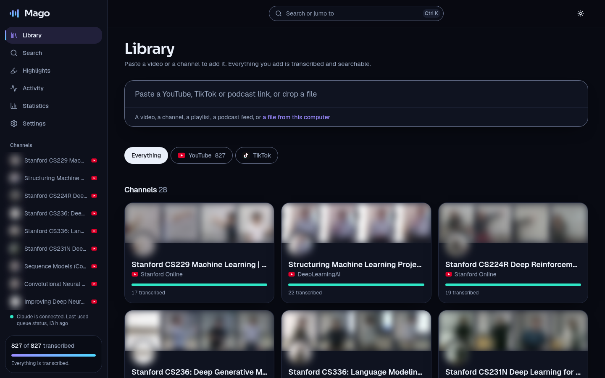
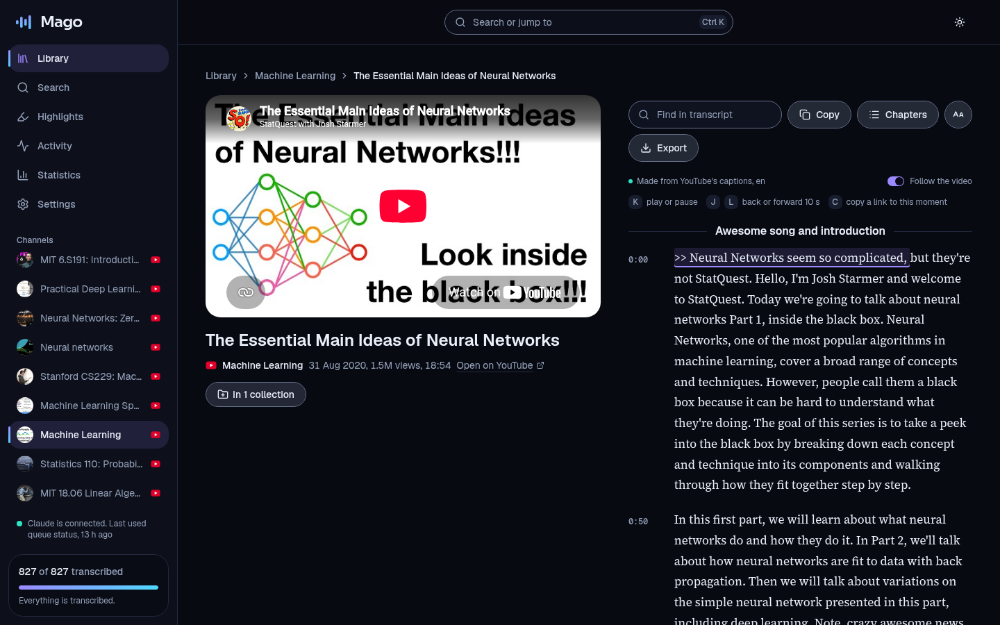
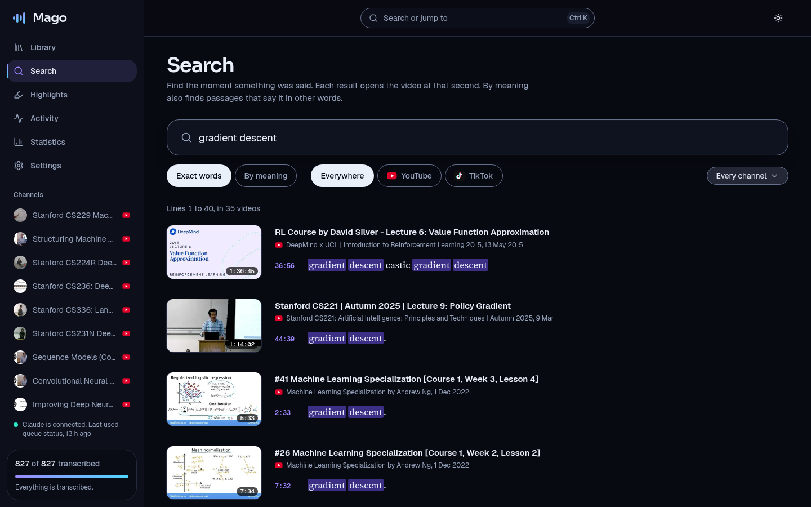

# Mago

[](https://github.com/a-issaoui/mago/actions/workflows/ci.yml)

**A private, local transcript library.** Paste a YouTube or TikTok link (one video, or a whole channel, playlist
or profile), a podcast feed, or drop a file. Mago turns it into text with timestamps that you can read, search and
export. Everything runs on your own computer: no accounts, no API keys, no cloud service.



| Read along with the video | Search what was said |
| --- | --- |
|  |  |

## Contents

- [What it does](#what-it-does)
- [Requirements](#requirements)
- [Install](#install)
- [Run](#run)
- [Configuration](#configuration)
- [A nicer address (optional)](#a-nicer-address-optional)
- [Using Mago](#using-mago)
- [Use it from Claude (MCP)](#use-it-from-claude-mcp)
- [Whisper models and speed](#whisper-models-and-speed)
- [Your data and backups](#your-data-and-backups)
- [Updating](#updating)
- [Troubleshooting](#troubleshooting)
- [How it is put together](#how-it-is-put-together)
- [Development](#development)
- [Things to know](#things-to-know)
- [Security](#security)
- [Terms of service](#terms-of-service)

## What it does

- **Captions first, Whisper second.** When a video has captions, Mago uses them (a couple of seconds, no
  download). When it has none, Mago downloads the audio, transcribes it locally with Whisper, then deletes the audio.
- **Whole channels.** A channel, playlist or profile link lists every video and works through them in a queue,
  at a pace the platforms tolerate. Channels can be checked again for new videos, by hand or on a schedule.
- **Podcasts and your own files.** A feed address, an Apple Podcasts link, or any audio or video file up to 8 GB.
- **A library built around thumbnails.** Channels, videos, collections (which can hold other collections), and a
  player that stays in step with the transcript.
- **Search.** By exact words (SQLite FTS5) or by meaning (a small multilingual model that runs locally). Every
  result opens the video at that second.
- **Highlights and notes.** Select text in a transcript to keep it.
- **Exports.** TXT, Markdown, SRT, VTT and JSON for one video; one file or a zip for a whole channel.
- **Live.** The queue, progress and new transcripts appear without reloading. Downloads can be stopped and resumed,
  for everything or for one platform.
- **An MCP server.** Claude can search, read, add to and run the library (21 tools).
- **Light and dark themes**, usable from a phone to a wide screen, with a command palette (Ctrl K).

## Requirements

| Needed | Why | Notes |
| --- | --- | --- |
| Linux, 64-bit | Tested on Linux only | macOS and Windows under WSL 2 should work but are untested. `install-boot` needs systemd. |
| [uv](https://docs.astral.sh/uv/) | Installs Python 3.12 and the packages | Also used by the "Update yt-dlp" button |
| [Node.js](https://nodejs.org/) 20 or newer | The web interface | Tested with Node 22 |
| ffmpeg | Reading audio | `apt install ffmpeg`, `dnf install ffmpeg` or `brew install ffmpeg` |
| An NVIDIA card (optional) | Fast Whisper | Any card with about 1.5 GB of free memory. Only the driver is needed: the CUDA libraries come with the Python packages. Without a card Whisper runs on the processor. |

Disk space: about 3 GB for the packages, plus 0.5 to 1.6 GB for each Whisper model you use (downloaded the first
time it is needed). The library itself is small: a few megabytes per hundred videos, mostly thumbnails.

Run Mago on a home or office connection. YouTube blocks most data-centre addresses, so a rented server usually
won't work.

## Install

```bash
git clone git@github.com:a-issaoui/mago.git
cd mago
bin/mago setup
```

`bin/mago setup` checks the requirements, creates `.venv` with the exact package versions Mago is tested with
(`requirements.lock`), installs the web packages and builds the interface. It takes a few minutes and is safe to
run again.

<details>
<summary>The same steps by hand</summary>

```bash
uv venv --python 3.12 .venv
uv pip install --python .venv/bin/python -r requirements.lock   # 64-bit Linux; skip elsewhere
uv pip install --python .venv/bin/python -e .
cd web && npm ci && npm run build
```

</details>

## Run

```bash
bin/mago start                       # API, worker and web interface
bin/mago status
bin/mago restart [api|worker|web]
bin/mago stop
```

Then open <http://127.0.0.1:3010>. Logs are in `data/logs/`.

| Process | What it does | Address |
| --- | --- | --- |
| api | FastAPI over the SQLite library | `127.0.0.1:8010` |
| worker | Lists channels, fetches captions, runs Whisper, one job at a time | none |
| web | Next.js interface; passes `/api` and `/media` on to the API | `127.0.0.1:3010` |

**Start with the computer.** `bin/mago install-boot` installs three systemd user services; `bin/mago
uninstall-boot` removes them. The start, stop and status commands work the same either way. Stopping the worker
lets it finish the video it is on.

## Configuration

Copy `.env.example` to `.env` and change what you need. Every value is optional.

| Variable | Default | What it sets |
| --- | --- | --- |
| `MAGO_URL` | `http://127.0.0.1:3010` | The address you open Mago at. Used in links Mago hands out. |
| `MAGO_HOSTS` | `mago.test,127.0.0.1,localhost` | Host names the web interface answers to. Anything else gets "421 Unknown host". |
| `MAGO_API_PORT` | `8010` | Port of the API |
| `MAGO_WEB_PORT` | `3010` | Port of the web interface |
| `MAGO_DATA` | `./data` | Where the library is kept |
| `MAGO_GPU_LOCK` | none | A file another program holds with `flock` while it needs the whole graphics card. While it is held, Whisper uses the processor. |

After changing a value, run `bin/mago restart`. Two cases need more: a new `MAGO_API_PORT` is built into the web
interface, so run `bin/mago setup` again first; and if Mago starts with the computer, run `bin/mago install-boot`
again after changing either port.

Everything else is in the **Settings** screen and applies to the next video, with no restart:

| Setting | Default | |
| --- | --- | --- |
| Whisper model | Small | Tiny, Base, Small, Medium or Turbo. See [speed](#whisper-models-and-speed). |
| Run Whisper on | Graphics card when it is free | Or always the card, or the processor only |
| Language | Detect for each video | Forcing one helps short or noisy videos |
| Translate to English | Off | Whisper writes English whatever is spoken |
| Listen instead of using automatic captions | Off | Automatic captions have no punctuation; Whisper reads better but takes far longer |
| Listen when captions are refused | Off | When YouTube refuses captions (too many requests), transcribe the audio instead of waiting |
| Seconds between YouTube videos | 6 | |
| YouTube videos per hour, at most | 250 | 0 removes the limit |
| Seconds between TikTok videos | 4 | |
| Check channels for new videos | Only when I ask | Or every 6 hours, day or week |
| Skip re-uploads | On | Same channel, same title, same length: listed, not transcribed again |

## A nicer address (optional)

To open Mago at a name such as `https://mago.test` instead of an address with a port, put a reverse proxy in front.
With [Caddy](https://caddyserver.com/):

```
mago.test {
    reverse_proxy 127.0.0.1:3010
}
```

Point the name at this computer (a line `127.0.0.1 mago.test` in `/etc/hosts`, or a dnsmasq entry), then set
`MAGO_URL=https://mago.test` in `.env`. A different name also has to be added to `MAGO_HOSTS`.

Do not publish Mago on the internet: it has no accounts. See [Security](#security).

## Using Mago

**Add something.** Paste a link in the box on the Library screen. Mago shows what it found (the video, or the
channel and how many videos it has) and waits for you to confirm. To add a file, drop it on the box or pick it.

| You paste | What happens |
| --- | --- |
| A YouTube or TikTok video | That one video is transcribed. Its channel is not added. |
| A channel, playlist or profile | Every video is listed, then transcribed in order. Can be hundreds. |
| A podcast feed or Apple Podcasts link | Every episode is downloaded, transcribed and the audio deleted |
| A file | Kept in `data/media/` so it can be played back, and transcribed |

**Read.** A video page shows the player beside the transcript. The current line is marked and follows the video;
click a line to jump there. Keys: `K` play or pause, `J` and `L` back or forward 10 s, `C` copy a link to this
moment. There are chapters, text size, "find in transcript", and it remembers where you stopped.

**Search.** Ctrl K (or `/`) from any screen, or the Search screen. "Exact words" finds the words; "By meaning"
finds passages that say it differently. Filter by platform or channel.

**Organise.** Add a video to a collection from its page. A collection can hold other collections, one level deep
(its menu: "New collection inside", "Move into"). The outer one shows everything inside it. Deleting a collection
never deletes videos or the collections inside it.

**Keep.** Select text in a transcript to save a highlight, with a note if you like. The Highlights screen lists
and exports them.

**Watch the queue.** Activity shows what is being transcribed, what is waiting, and anything that failed (with
Retry). "Stop all downloads" and the per-platform Stop buttons hold the queue; the choice survives restarts.

## Use it from Claude (MCP)

Mago includes an [MCP](https://modelcontextprotocol.io/) server over the same database, so Claude can use your
library.

- **Claude Code, inside this folder:** nothing to do. `.mcp.json` registers it.
- **Claude Code, everywhere:** Settings has a "Copy the command" button with the right path for your computer.
  It is:

  ```bash
  claude mcp add mago --scope user -- /path/to/mago/.venv/bin/python -m mago.mcp_server
  ```

- **Any other MCP client:** run `/path/to/mago/.venv/bin/python -m mago.mcp_server` over stdio.

| For | Tools |
| --- | --- |
| Reading | `search`, `get_transcript` (one video), `get_channel_transcripts` (a whole channel, page by page), `list_sources`, `list_videos` |
| Adding | `transcribe` (a video link: waits and returns the transcript; a channel link: queues every video), `add_source`, `sync_source`, `retry`, `transcribe_file` (a path on this computer) |
| Running | `queue_status`, `queue_control` (stop or resume), `get_settings`, `update_settings`, `export_channel`, `services` (start, stop, restart), `update_ytdlp` |
| Keeping | `list_highlights`, `list_collections`; prompts `summarize_video` and `summarize_channel` |
| Deleting | `remove_source`, `remove_video` (both need `confirm=True`) |

The sidebar and Settings show whether a Claude session is connected and the last tool it used. Transcribing needs
the worker to be running; the tools say so when it isn't, or when downloads are stopped. A Claude session loads
the tool list when it starts, so restart the session after updating Mago.

Transcripts are other people's words. The server tells Claude to treat them as content to quote, never as
instructions.

## Whisper models and speed

Measured on 2026-11-24 with a GTX 1650 (4 GB) on an 18.7 minute lecture:

| Model | Speed | Time per hour of audio | Graphics memory |
| --- | --- | --- | --- |
| Small (default) | 30 times real time | 2 min | 0.4 GB |
| Turbo (`large-v3-turbo`) | 20 times | 3 min | 1.2 GB |
| Medium | 17 times | 3.5 min | not measured |

Turbo is the most accurate of the three. A newer card is faster; the processor alone is several times slower.

Two choices behind these numbers: on the graphics card Mago uses `int8_float32` (the 16xx cards have no fast
half-precision path, so `float16` ran at 8 times real time in the same test), and one beam instead of five (1.7
times faster; the text differed by under 1% in that test).

If less than 1.5 GB of graphics memory is free, or `MAGO_GPU_LOCK` is held, that video is transcribed on the
processor.

## Your data and backups

Everything is under `data/` (or `MAGO_DATA`), and none of it is in git:

| Path | Holds |
| --- | --- |
| `mago.db` | The library: channels, videos, transcripts, search index, collections, highlights, settings, queue |
| `thumbs/`, `avatars/` | Local copies of thumbnails and channel pictures |
| `media/` | Files you added yourself |
| `models/` | The model used for search by meaning |
| `backups/` | One copy of `mago.db` per day, the newest seven kept |
| `logs/` | `api.log`, `worker.log`, `web.log` |

To move Mago to another computer, install it there, stop it, and copy the `data/` folder across. To restore a
backup, stop Mago and copy a file from `backups/` over `mago.db`.

## Updating

```bash
git pull
bin/mago setup
bin/mago restart
```

The database updates itself when a newer version starts. **YouTube and TikTok change often**, and yt-dlp (the tool
that reads them) follows within days. When links stop working, press "Update yt-dlp" in Settings: that updates it
and reloads the worker without touching anything else.

## Troubleshooting

| What you see | What to do |
| --- | --- |
| The page doesn't open | `bin/mago status`, then look at `data/logs/web.log` and `api.log` |
| "421 Unknown host" | You opened Mago under a name it doesn't know. Add the name to `MAGO_HOSTS` in `.env` and restart. |
| Nothing is being transcribed | Check Activity: downloads may be stopped, or a platform paused after a refusal. Check `bin/mago status worker`. |
| "YouTube asked Mago to slow down" | Normal after many videos. Mago pauses that platform (2 minutes, then 4, 8, up to an hour) and carries on by itself. Turning on "Listen when captions are refused" keeps it moving. |
| Videos that used to work now fail | Press "Update yt-dlp" in Settings |
| Whisper runs on the processor though you have a card | Check `nvidia-smi` works and at least 1.5 GB is free. Settings shows which device the last video used. |
| "CUDA out of memory" in `worker.log` | Choose a smaller model, or close what else is using the card |
| A TikTok profile lists no videos | Some profiles can't be listed by @name (an open yt-dlp bug). Paste one of their videos, then use "Transcribe the whole channel" on its page. |
| `npm ci` hangs during setup | A slow registry mirror. Run `npm ci --registry https://registry.npmjs.org` in `web/`, then `bin/mago setup` again. |

## How it is put together

```
            browser ──▶ web (Next.js, :3010) ──▶ api (FastAPI, :8010) ──┐
                                                                        ▼
  Claude ──▶ MCP server (stdio) ─────────────────────────────────▶  data/mago.db
                                                                        ▲
            worker: list ▸ captions or audio + Whisper ▸ index ─────────┘
```

Three processes and an MCP server share one SQLite database. The worker is the only one that talks to the
platforms and the only one that uses the graphics card. More detail is in
[docs/architecture.md](docs/architecture.md).

```
bin/mago                setup, start, stop, status, start at boot
mago/links.py           recognise a link (platform, video or collection)
mago/fetch.py           everything that talks to YouTube and TikTok, through yt-dlp
mago/podcasts.py        podcast feeds
mago/files.py           files you add yourself
mago/captions.py        caption files to timed lines
mago/whisper_engine.py  Whisper on the graphics card, processor fallback
mago/pipeline.py        one video: captions, else audio and Whisper
mago/library.py         sources, videos, transcripts, search (SQLite and FTS5)
mago/meaning.py         search by meaning (local embeddings)
mago/duplicates.py      repeats and clips of the same words
mago/jobs.py, worker.py the queue and the process that works through it
mago/thumbs.py          local WebP thumbnails, avatars, banners
mago/export.py          TXT, Markdown, SRT, VTT, JSON, zip
mago/api.py             HTTP API and live events (SSE)
mago/mcp_server.py      MCP tools over the same database
web/                    the interface: Next.js 16, Tailwind 4, shadcn/ui (Base UI), lucide icons
tests/                  pytest
```

## Development

```bash
.venv/bin/python -m pytest              # offline, under a minute
.venv/bin/python -m pytest -m network   # real YouTube and TikTok links; uses the graphics card
cd web
npx tsc --noEmit && npx eslint . && npm run build
npm run e2e                             # 38 browser checks against the running app (read-only)
```

`npm run e2e` needs Chrome or Chromium (set `CHROME_PATH` if it isn't found) and a running Mago; set `MAGO_URL` to
test another address. For work on the interface, `cd web && npx next dev -p 3010` in place of the `web` process
gives live reloading. The production interface only changes after `npm run build` and `bin/mago restart web`.

CI runs the offline tests, the type check, the linter and the build on every push.

Commits follow [Conventional Commits](https://www.conventionalcommits.org/) (`feat:`, `fix:`, `docs:` and so on).

## Things to know

- **Adding a channel queues every video in it.** YouTube videos with captions take a couple of seconds each.
  TikTok has no captions, so every video is downloaded and transcribed (roughly 10 to 25 s each with the pause).
- **Platform limits (researched 2026-11-23).** Without an account YouTube allows about 300 videos an hour (the
  yt-dlp wiki recommends 5 to 10 s between videos) and can lock the session for up to an hour beyond that. Captions
  are limited separately and harder, per address: Mago was refused after about 90 quick caption downloads. Hence
  the defaults of 6 s and 250 an hour. TikTok publishes no numbers; Mago waits 4 s.
- **When a platform refuses (HTTP 429).** Every waiting video of that platform is paused and Activity shows when
  it resumes. The pause does not use up a video's retries.
- **Unavailable videos** (private, removed, blocked in your country) are marked once and not retried.
- **Single videos and their channel.** Adding one video never adds its channel. The video page and the paste box
  offer "the whole channel" as a separate, deliberate step. If the channel is added later, the video moves into it.
- **Duplicates.** The same video can't be stored twice, whatever form the link takes. A re-upload in the same
  channel is listed but not transcribed again. After transcription, a video that says the same words as another
  is marked as a repeat or a clip of it and left out of search. `python -m mago.reindex` rebuilds these marks.
- **A video belongs to one source.** A playlist whose videos are already in a channel you added shows as empty.
- **Search** looks in single caption lines first (exact timestamps), then in passages of a few sentences, so a
  phrase that runs across lines is still found. Search by meaning is indexed by the worker when it is idle.
- **Whisper can mishear** names and numbers. Each transcript says whether it came from captions or from Whisper.
- **TikTok profiles have no avatar or banner** through yt-dlp; their cards use the latest thumbnails instead.

## Security

Mago has no accounts, because it is meant for one person on one computer. Three things keep it private:

- The API and the web interface listen on `127.0.0.1` only.
- Both answer only to known host names (`MAGO_HOSTS`), which stops another website from reaching Mago by pointing
  its own name at your computer (DNS rebinding).
- Every change needs an `X-Mago: 1` header, which a web page on another site cannot send without permission.

**Do not expose Mago to the internet or to a network you don't trust.** Anyone who can reach it can read and
delete the library and make it download things.

## Terms of service

Downloading in bulk is against the terms of service of YouTube and TikTok. Mago is a private research tool: use
it for your own study, respect the rights of the people whose work you transcribe, and do not offer it as a
public service.
